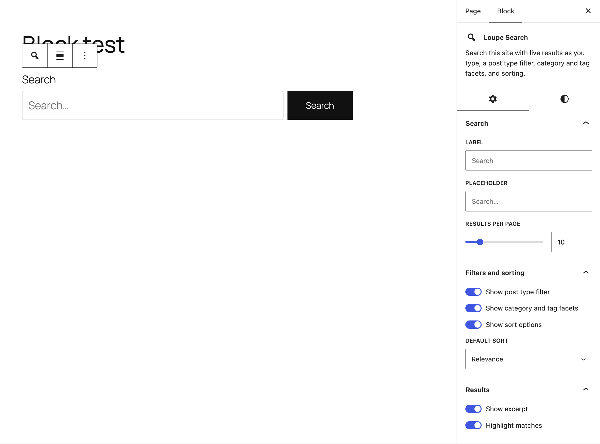

# Loupe Search Block

A search block for [Loupe Search](https://github.com/soderlind/loupe-search): live results as you type, a post type filter, taxonomy, author and custom-field facets, a date range filter, and sorting.

Loupe Search itself is engine-only. This add-on talks to it only through its public REST API ([ADR 0002](https://github.com/soderlind/loupe-search/blob/main/docs/adr/0002-search-block-ships-as-add-on.md)).


https://github.com/user-attachments/assets/2a1d6865-4ebb-41eb-9a22-ca9ca5e46bdb


## Requirements

- WordPress 6.9+
- PHP 8.3+
- [Loupe Search](https://github.com/soderlind/loupe-search) 1.4.0+ (needs the `GET /search-fields` route)

## Features

- **Search as you type**, with results, facets, sorting and pagination inside the block (Interactivity API).
- **Post type filter** for every post type Loupe Search indexes.
- **Taxonomy facets** (categories, tags and custom taxonomies) with result counts, for fields marked *Filterable* in Settings → Loupe Search.
- **Author facet** with result counts, showing author names. Mark *Post Author* (`post_author`) as *Filterable* for the post type.
- **Custom field facets**: every other *Filterable* field (for example a custom field) gets a facet with result counts.
- **Date range filter** (*Published* From / To). Needs `post_date` to be *Filterable*. Off by default.
- **Sort**: Relevance, Newest first, Oldest first, Title A–Z, Title Z–A. Date sorts need `post_date` to be *Sortable*; title sorts need `post_title` to be *Sortable*. Options that are not allowed are hidden.
- **Highlighted snippets** around the matched words.
- **Works without JavaScript**: the block falls back to a plain search form that submits `?s=` to the site's search page.
- **Search insights**: only the query a visitor settles on (or submits with Enter) is counted in Loupe Search's [Search insights](https://github.com/soderlind/loupe-search#search-insights), so search-as-you-type does not inflate the numbers.

Facets and sorts follow Loupe Search's rules: when a search covers several post types, a field is only offered if it is allowed for all of them.

## Usage

1. Install and activate Loupe Search, and reindex.
2. Install and activate Loupe Search Block.
3. Add the **Loupe Search** block (`loupe-search/search`) to a page or template.

### Block settings

| Setting | Default | Notes |
| --- | --- | --- |
| Label | “Search” | |
| Placeholder | “Search…” | |
| Results per page | 10 | 1–100 |
| Show post type filter | On | Hidden when only one post type is indexed |
| Show taxonomy facets | On | Categories, tags and custom taxonomies |
| Show author filter | On | Needs `post_author` to be *Filterable* |
| Show custom field facets | On | Every other *Filterable* field |
| Show date filter | Off | Needs `post_date` to be *Filterable* |
| Show sort options | On | |
| Default sort | Relevance | Falls back to Relevance if the field is not *Sortable* |
| Show excerpt | On | |
| Highlight matches | On | |

The block also supports wide/full alignment, margin, padding, and text and background colors.



### Filters

```php
// Reorder or remove facet fields, e.g. a geo field that cannot be listed as values.
add_filter( 'loupe_search_block_facet_fields', function ( array $facets, array $filterable ) {
	return array_values( array_diff( $facets, [ 'my_geo_field' ] ) );
}, 10, 2 );

// Change a facet's heading.
add_filter( 'loupe_search_block_facet_label', function ( string $label, string $field ) {
	return 'loupe_color' === $field ? 'Colour' : $label;
}, 10, 2 );
```

Fields returned by `loupe_search_block_facet_fields` that are not *Filterable* are dropped.

## Development

```sh
npm install
composer install
npm run build      # or: npm start
npm test           # Jest
composer test      # PHPUnit
npm run lint:js
```

## License

GPL-2.0-or-later. See [LICENSE](LICENSE).
